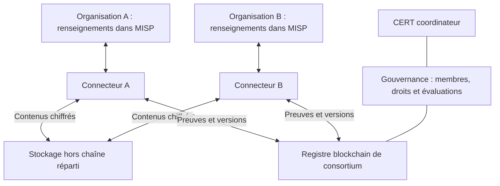

# ZeroTrustChain — Cadrage du projet et état de l’art initial

> **Statut : document de travail**, établi le 22 novembre 2026 à partir de la note fournie pour le projet. Cette synthèse organise les informations recueillies ; les orientations présentées restent à discuter et à valider.

## 1. Objet de cette documentation

Ce dossier rassemble les connaissances nécessaires pour comprendre le projet : son contexte, sa problématique, les travaux scientifiques identifiés et son architecture générale. Il servira de base aux échanges avec l’encadrant et à la rédaction progressive de l’état de l’art.

Le présent document reste au niveau conceptuel. Les instructions d’installation, le code et les détails de configuration seront documentés lors de la réalisation.

```text
Docs/
├── README.md                  # Cadrage et synthèse de l’état de l’art
├── articles/
│   └── README.md              # Index des articles et trame de fiche de lecture
└── sources/
    └── note-initiale.txt      # Texte fourni à l’origine de cette synthèse
```

**Origine des informations.** Les descriptions des publications ci-dessous proviennent de la [note initiale](sources/note-initiale.txt). Les articles n’ont pas été relus ni leurs références vérifiées indépendamment lors de la création de ce dossier. Cette base bibliographique ne constitue donc pas encore une revue systématique ou une analyse critique des textes intégraux. Les liens permettent d’engager ce travail.

## 2. Contexte et idée générale

Les organisations disposent d’informations sur les menaces qu’elles rencontrent : domaines suspects, adresses IP, campagnes de phishing, observations et éléments de contexte. Le partage de ces renseignements peut aider d’autres organisations à détecter ou à comprendre des attaques similaires.

Ce partage soulève cependant plusieurs questions : comment identifier l’origine d’une publication, vérifier qu’elle n’a pas été altérée, limiter sa diffusion et conserver les corrections ou les désaccords entre participants ? Les organisations doivent également garder la maîtrise de leurs données sensibles.

**L’idée du projet est de combiner une plateforme de renseignement sur les menaces, MISP, avec un registre blockchain partagé entre plusieurs organisations.** MISP servirait à gérer et exploiter les renseignements. Le registre conserverait des preuves de publication, des versions et certaines décisions communes. Les contenus sensibles resteraient hors de la blockchain.

Le nom ZeroTrustChain est utilisé ici pour désigner le projet. Le rattachement à un modèle formel de sécurité Zero Trust reste à préciser ; le nom seul ne constitue pas une propriété démontrée de l’architecture.

## 3. Problématique et contribution envisagée

> Comment permettre à plusieurs organisations de partager des renseignements de menace vérifiables, avec une diffusion contrôlée et un historique commun, tout en conservant les données sensibles hors de la blockchain ?

La contribution envisagée est de **concevoir et évaluer une intégration MISP–Ethereum permettant un partage confidentiel, une vérification de l’intégrité des publications et une traçabilité commune**.

Il s’agit à ce stade d’une contribution d’ingénierie à étudier. Une éventuelle nouveauté scientifique devra être établie par une comparaison détaillée avec les travaux existants.

### Les cinq questions centrales

| Dimension | Question pour le projet |
|---|---|
| Provenance | Quelle organisation a publié le renseignement et quelle version a été reçue ? |
| Intégrité | Le contenu reçu correspond-il au contenu associé à la preuve enregistrée ? |
| Confidentialité | Qui peut accéder au renseignement et à ses différentes parties ? |
| Qualité | Le renseignement est-il pertinent, récent et étayé par des observations ? |
| Gouvernance | Qui peut rejoindre le consortium, publier, évaluer ou révoquer un membre ? |

**L’intégrité ne prouve pas la véracité.** Vérifier une empreinte permet de détecter une modification du contenu par rapport à une référence. Cela ne démontre pas qu’un domaine ou une adresse IP est réellement malveillant. Cette appréciation demande du contexte, des observations et éventuellement plusieurs évaluations.

## 4. Positionnement par rapport à MISP

La note rappelle que MISP possède déjà des fonctions de partage entre instances, des groupes de partage, des contrôles de diffusion, des signatures et des journaux d’activité. Le projet doit donc partir des capacités existantes de MISP et identifier précisément ce que le registre commun ajouterait.

L’apport à étudier concerne un **historique partagé entre organisations ayant des administrations distinctes**. Il faudra déterminer si ce fonctionnement apporte une valeur suffisante pour justifier sa complexité et son coût.

Les comparaisons envisagées sont :

- **MISP seul**, comme référence fonctionnelle de partage ;
- **MISP avec une couche blockchain**, comme proposition du projet ;
- si le temps le permet, **MISP avec un journal signé sans blockchain**, pour mieux isoler l’intérêt du consensus distribué.

## 5. État de l’art : corpus initial

Les références suivantes sont reprises du document fourni. Leur apport est présenté comme une piste de lecture pour le projet, et non comme un résultat de validation réalisé par notre équipe.

### R1 — Vue d’ensemble du domaine

**Dimitrios Chatziamanetoglou et Konstantinos Rantos — « Cyber Threat Intelligence on Blockchain: A Systematic Literature Review », Computers, 2024.**

La note décrit une revue des approches associant renseignement sur les menaces et blockchain : partage, confidentialité, réputation, qualité et confiance. Elle signale des niveaux de maturité variables, souvent expérimentaux.

**Intérêt pour le projet :** organiser les familles de solutions et construire une grille de comparaison avant de retenir une architecture.

[Article et DOI](https://doi.org/10.3390/computers13030060) · [PDF référencé](https://wesis.cs.duth.gr/wesis_hosting/papers/en_37.pdf)

### R2 — Intégration de MISP et d’un registre distribué

**Davy Preuveneers, Wouter Joosen, Jorge Bernal Bernabe et Antonio Skarmeta — « Distributed Security Framework for Reliable Threat Intelligence Sharing », Security and Communication Networks, 2020.**

Selon la note, cette extension du framework TATIS combine MISP, une passerelle de contrôle d’accès, du chiffrement et une blockchain permissionnée MultiChain. Les événements restent dans MISP ; le registre conserve des empreintes et des informations de provenance.

**Intérêt pour le projet :** étudier comment ajouter une couche de confiance autour de MISP. La couverture de la traçabilité doit être examinée : la note indique que les échanges contournant la passerelle échappent au registre.

[Article et DOI](https://doi.org/10.1155/2020/8833765) · [PDF référencé](https://onlinelibrary.wiley.com/doi/pdf/10.1155/2020/8833765)

### R3 — Ethereum et partage sélectif

**Kealan Dunnett et collaborateurs — « A Trusted, Verifiable and Differential Cyber Threat Intelligence Sharing Framework using Blockchain », IEEE TrustCom, 2022.**

La note présente un prototype Ethereum permettant de partager différentes parties d’un renseignement selon le destinataire tout en vérifiant leur intégrité. Le terme « differential sharing » désigne ici la divulgation sélective, et non la confidentialité différentielle par ajout de bruit.

**Intérêt pour le projet :** analyser le lien entre vérifiabilité et diffusion sélective. Par exemple, un domaine malveillant pourrait être partagé largement au sein du consortium, tandis que les détails du système compromis seraient réservés à certains membres.

[Publication et DOI](https://doi.org/10.1109/TrustCom56396.2022.00152) · [Notice arXiv](https://arxiv.org/abs/2208.12031) · [PDF](https://arxiv.org/pdf/2208.12031)

### R4 — Gouvernance et protection de l’identité

**Yair Allouche et collaborateurs — « TRADE: TRusted Anonymous Data Exchange: Threat Sharing Using Blockchain Technology », prépublication arXiv, 2021.**

TRADE est présenté dans la note comme une approche combinant politiques de partage par contrats intelligents, séparation entre identité et activité, et intégration avec des mécanismes tels que TAXII.

**Intérêt pour le projet :** préciser les conditions d’adhésion, les droits d’accès et la responsabilité des participants. L’utilisation d’adresses blockchain ne suffit pas à garantir l’anonymat.

**Statut bibliographique retenu :** prépublication pour la version citée ; une éventuelle version publiée reste à rechercher.

[Notice arXiv](https://arxiv.org/abs/2103.13158) · [PDF](https://arxiv.org/pdf/2103.13158)

### R5 — Résistance aux faux contributeurs

**Seonghyeon Gong et Changhoon Lee — « BLOCIS: Blockchain-Based Cyber Threat Intelligence Sharing Framework for Sybil-Resistance », Electronics, 2020.**

La note décrit un mécanisme associant contrats intelligents, évaluation des contributions, dépôts et récompenses pour traiter les attaques Sybil, où un acteur multiplie les identités afin d’influencer le système.

**Intérêt pour le projet :** étudier l’admission des membres et l’évaluation des contributions. L’admission contrôlée des organisations constitue une piste plus limitée pour un premier prototype ; une économie de jetons resterait une extension à justifier.

[Article et DOI](https://doi.org/10.3390/electronics9030521) · [PDF référencé](https://www.mdpi.com/2079-9292/9/3/521/pdf)

### R6 — Motivation et contribution des participants

**Xingbang Ma et collaborateurs — « A Blockchain-Based Incentive Mechanism for Sharing Cyber Threat Intelligence », Electronics, 2023.**

Selon la note, B-CTISM traite le cas des participants qui consomment les renseignements sans contribuer. Le mécanisme s’appuie sur la théorie des jeux évolutionnaires et des contrats intelligents, avec une évaluation par simulation et comparaison.

**Intérêt pour le projet :** intégrer la question des motivations organisationnelles. Une éventuelle réputation devrait tenir compte de la qualité des apports : compter seulement les publications pourrait encourager les doublons.

[Article et DOI](https://doi.org/10.3390/electronics12112454)

### R7 — Architecture combinant plusieurs mécanismes

**Hisham Ali et collaborateurs — « TrustShare: Secure and Trusted Blockchain Framework for Threat Intelligence Sharing », Future Internet, 2025.**

La note présente une combinaison de Hyperledger Fabric, stockage chiffré hors chaîne sur IPFS, chiffrement par attributs CP-ABE, STIX/TAXII et rattachement à MITRE ATT&CK. Elle mentionne également le contrôle d’accès et la révocation.

**Intérêt pour le projet :** comparer la séparation entre contenus, preuves et autorisations. L’étendue de cette architecture invite à limiter le premier prototype à des propriétés mesurables plutôt qu’à reprendre toutes ses briques.

[Article et DOI](https://doi.org/10.3390/fi17070289) · [PDF référencé](https://www.mdpi.com/1999-5903/17/7/289/pdf)

### R8 — Exigences et menaces

**« A Review of Requirements and Threats in Blockchain-Based Cyber Threat Intelligence Sharing », IEEE SRDS, 2025.**

La note rapporte une analyse des exigences de sécurité, de fiabilité, de réputation et des contrats intelligents. Elle mentionne la validation des formats et l’identité décentralisée parmi les défis ouverts.

**Intérêt pour le projet :** construire une comparaison fondée sur les exigences et les menaces. Les auteurs et les métadonnées complètes restent à relever sur la notice officielle.

**Limite de la source fournie :** sa synthèse repose uniquement sur le résumé accessible, sans lecture du texte intégral. Ses conclusions ne doivent pas être généralisées avant cette lecture.

[Notice IEEE](https://ieeexplore.ieee.org/abstract/document/11360467) · [DOI](https://doi.org/10.1109/SRDS69199.2025.00050)

### R9 — Cadre institutionnel du partage

**NIST SP 800-150 — « Guide to Cyber Threat Information Sharing ».**

Ce guide est proposé dans la note pour cadrer les objectifs du partage, les relations de confiance et les règles de publication. Son rôle dans le corpus est organisationnel ; il ne constitue pas une proposition d’architecture blockchain.

[Notice officielle et accès au document](https://csrc.nist.gov/pubs/sp/800/150/final)

### Synthèse transversale à approfondir

| Axe de lecture | Références de départ | Question à approfondir |
|---|---|---|
| Panorama et exigences | R1, R8, R9 | Quelles propriétés sont attendues et comment les évaluer ? |
| Intégration avec l’existant | R2 | Comment conserver les usages MISP tout en traçant les échanges concernés ? |
| Intégrité et partage sélectif | R3 | Comment vérifier une publication dont seule une partie est divulguée ? |
| Gouvernance et identité | R4, R5 | Comment admettre les membres et limiter les abus ? |
| Qualité et participation | R5, R6 | Comment encourager des contributions utiles et étayées ? |
| Séparation des responsabilités | R2, R7 | Où placer le contenu, les preuves et les règles d’accès ? |

Cet ensemble fait apparaître plusieurs dimensions complémentaires du problème. La comparaison détaillée devra relever, pour chaque travail, les hypothèses de confiance, la visibilité des données, les limites annoncées et les conditions d’évaluation. Une propriété non décrite dans la note doit être marquée **« à vérifier »**, sans conclure qu’elle est absente de l’article.

## 6. Architecture générale envisagée

### Acteurs et responsabilités

Le scénario cible proposé représente **trois organisations et un CERT coordinateur**. Chaque organisation conserverait son environnement CTI et la maîtrise de ses publications. Les responsabilités exactes du CERT, notamment son rôle dans l’admission et la résolution des désaccords, restent à définir.

| Élément | Responsabilité envisagée |
|---|---|
| Organisation participante | Produire des renseignements, choisir leur diffusion et évaluer les contributions reçues |
| MISP | Créer, enrichir, rechercher et exploiter les renseignements |
| Connecteur de partage | Préparer les échanges autorisés et relier MISP au registre commun |
| Stockage hors chaîne | Conserver les paquets chiffrés et leurs répliques |
| Blockchain de consortium | Conserver un historique commun des preuves, versions et décisions prévues par la gouvernance |
| Règles communes | Encadrer les membres, les publications et les évaluations |
| CERT coordinateur | Participer à la coordination du consortium, selon un mandat à préciser |

### Schéma conceptuel

Le schéma illustre deux organisations pour rendre le flux lisible ; la troisième suivrait le même principe. La coordination du CERT est représentée séparément des échanges de contenu.



### Répartition de l’information

| Dans le registre commun — proposition | Hors chaîne — proposition |
|---|---|
| Identifiant de publication et version | Contenu détaillé des événements |
| Identifiant du signataire autorisé | Indicateurs et observations |
| Empreinte du paquet chiffré | Journaux et pièces justificatives |
| Référence aux règles de diffusion | Identités et détails sensibles |
| Statuts, liens de correction et évaluations prévues | Clés, secrets et justifications sensibles |

La visibilité des métadonnées et des évaluations doit elle-même être étudiée : conserver le contenu hors chaîne ne supprime pas toutes les possibilités de déduire des informations sur les participants.

### Orientations technologiques citées dans la note

MISP et l’écosystème Ethereum constituent l’orientation proposée. La note cite Python/PyMISP pour les connecteurs, Web3.py pour la liaison avec le registre, Solidity pour les contrats et Besu avec QBFT pour un réseau permissionné. Ces éléments sont des pistes de réalisation, pas des choix définitivement validés.

STIX 2.1 est envisagé pour structurer les échanges ; TAXII concerne leur transport. MITRE ATT&CK pourrait apporter un contexte sur les techniques d’attaque, lorsque les observations justifient ce rapprochement. Le choix du stockage hors chaîne reste ouvert : IPFS apparaît dans un travail étudié, sans être retenu à ce stade pour le projet.

## 7. Exemple de fonctionnement

1. L’organisation A détecte une campagne de phishing et documente un événement dans MISP.
2. Elle précise ses observations, son niveau de confiance et les destinataires autorisés.
3. Son connecteur prépare une version partageable et un paquet chiffré.
4. Une preuve du paquet et sa version sont inscrites dans le registre commun.
5. L’organisation B, si elle est autorisée, récupère le paquet, vérifie son intégrité et accède au contenu déchiffré.
6. B peut ajouter une observation confirmant ou contestant le renseignement.
7. Si A corrige sa publication, une nouvelle version conserve le lien avec la précédente.

Ce scénario permettrait de démontrer cinq actions : **publier, autoriser, vérifier, évaluer et corriger**.

## 8. Limites et hypothèses à conserver dans le cadrage

- Une information fausse peut avoir une empreinte parfaitement valide. La qualité exige une évaluation distincte.
- Les règles inscrites dans le registre doivent être appliquées aussi lors de l’accès au contenu et de la distribution des clés.
- Retirer un droit d’accès ne permet pas d’effacer une copie déjà déchiffrée par son destinataire.
- Une simple empreinte d’adresse IP ou de domaine ne protège pas suffisamment ces valeurs contre une recherche par essais. La note propose d’étudier l’empreinte du paquet chiffré exact.
- La traçabilité dépend des chemins d’échange effectivement couverts par le dispositif.
- Un consortium simulé sur un seul ordinateur ne démontre pas l’indépendance réelle des administrations participantes.
- La conservation d’une preuve dans le registre ne garantit pas la disponibilité du contenu stocké hors chaîne.

## 9. Périmètre initial et évaluation envisagée

Le premier démonstrateur pourrait se limiter à **deux instances MISP** pour montrer un échange complet, avec un réseau local représentant le consortium. Le scénario à trois organisations et un CERT resterait le cadre cible.

Le socle proposé couvre la publication, la diffusion contrôlée, le chiffrement, la vérification d’intégrité, la gestion des versions et une évaluation justifiée par organisation. Les échanges utiliseraient d’abord des données synthétiques maîtrisées, puis éventuellement un échantillon de renseignements publics.

Les mécanismes de récompense, une réputation avancée et l’utilisation opérationnelle avec Suricata ou Wazuh constituent des extensions possibles après validation du partage.

### Questions d’évaluation

| Situation à observer | Propriété à examiner |
|---|---|
| Un paquet est modifié après publication | Détection de l’altération |
| Un participant demande un contenu sans autorisation | Application des règles d’accès |
| Une publication identique est réémise | Gestion des doublons et des rejeux |
| Un indicateur est corrigé | Lisibilité de l’historique et des versions |
| Un renseignement volontairement faux est publié | Séparation entre intégrité et qualité |
| Un nœud ou une réplique devient indisponible | Disponibilité et limites de résilience |
| Le volume de publications augmente | Délais, capacité de traitement et ressources nécessaires |

Ces évaluations sont **prévues**, sans résultats disponibles à ce stade. La comparaison avec MISP seul devra permettre d’identifier les bénéfices et les surcoûts de la couche blockchain.

## 10. Travail documentaire à poursuivre

L’ordre de lecture suggéré dans la note est : **R1 → R2 → R3 → R7**. Il permet de partir du panorama général, puis d’étudier l’intégration MISP, le partage sur Ethereum et une architecture combinant plusieurs mécanismes.

Pour chaque lecture, une fiche sera ajoutée dans [articles/](articles/README.md). Les prochaines étapes documentaires sont les suivantes :

- vérifier les auteurs, dates, versions et DOI de chaque référence ;
- distinguer les informations issues d’un résumé de celles confirmées dans le texte intégral ;
- relever les modèles de confiance, les résultats expérimentaux et les limites de chaque approche ;
- comparer les solutions selon les cinq dimensions du projet ;
- préciser la gouvernance du consortium, les données partagées et les règles d’évaluation ;
- justifier les choix d’architecture à partir de cette comparaison.

## 11. Repères terminologiques

| Terme | Sens dans ce document |
|---|---|
| CTI — Cyber Threat Intelligence | Renseignement sur les cybermenaces, associant des indicateurs à des observations et à du contexte |
| Indicateur de compromission — IoC | Élément observable, tel qu’un domaine ou une adresse IP, susceptible de contribuer à l’identification d’une menace |
| MISP | Plateforme de gestion et de partage de renseignements sur les menaces |
| CERT | Équipe de réponse aux incidents de sécurité informatique |
| Consortium | Ensemble d’organisations participant au réseau selon des règles communes |
| Blockchain permissionnée | Registre distribué dont la participation est soumise à autorisation |
| Empreinte — hash | Résumé calculé d’un contenu, utilisé ici pour vérifier sa correspondance avec une référence |
| Hors chaîne | Données conservées en dehors du registre blockchain |
| Contrat intelligent — smart contract | Programme du registre appliquant certaines règles communes |
| STIX / TAXII | Respectivement un format de représentation des renseignements et un protocole d’échange |
| MITRE ATT&CK | Base de connaissances sur les tactiques et techniques d’attaque |
| Attaque Sybil | Utilisation de plusieurs identités contrôlées par un acteur pour influencer un système |

## 12. Ressources complémentaires citées dans la note

- [Fonctionnalités de MISP](https://misp-project.org/features/)
- [Spécification STIX 2.1 — OASIS](https://docs.oasis-open.org/cti/stix/v2.1/os/stix-v2.1-os.html)
- [Documentation Besu — QBFT](https://docs.besu-eth.org/private-networks/how-to/configure/consensus/qbft)

Ces ressources accompagnent les orientations de la note initiale. Leur consultation et leur vérification devront être consignées lors des travaux suivants.
